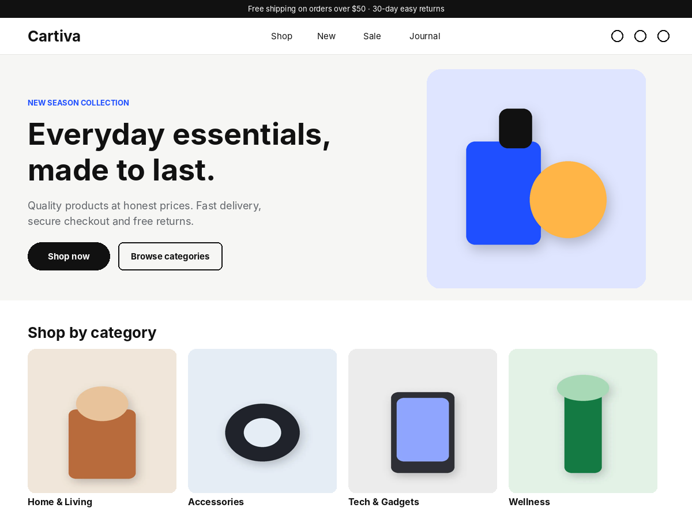

<div align="center">

# Cartiva

**A free, lightweight and modern WooCommerce block theme for WordPress.**

Built 100% for the Site Editor (Full Site Editing): no page builder, no jQuery, system fonts by default.

[](https://wordpress.org/)
[](https://woocommerce.com/)
[](https://www.php.net/)
[](https://www.gnu.org/licenses/gpl-2.0.html)
[](readme.txt)

[Features](#features) · [Installation](#installation) · [Patterns](#block-patterns) · [Development](#development) · [Roadmap](#roadmap)



</div>

---

## Overview

Cartiva gives store owners the polished, conversion-focused design of a premium WooCommerce theme with the weight of a default WordPress theme, and it's completely free. Every part of the store is a native block, so headers, footers, product pages and the shop archive can all be edited visually in **Appearance → Editor**.

Cartiva is developed by **[godevs](https://godevs.net/)** and is being prepared for the [WordPress.org theme directory](https://wordpress.org/themes/).

## Features

| | |
|---|---|
| ⚡ **Performance first** | Zero theme JavaScript, system fonts by default (bundled DM Sans and Lora load only when chosen) and per-block CSS loaded only where a block is used. |
| 🧱 **True block theme** | Templates, template parts and patterns, all designed in `theme.json`. No custom options panel. |
| 🛒 **WooCommerce ready** | Shop, product category, product tag, product search and single product templates built with WooCommerce blocks. |
| 🧭 **Store header** | Announcement bar, logo, navigation, product search, account icon and mini-cart. |
| 🎨 **Style variations** | Default, Midnight (dark), Sand and Fresh, plus typography presets: System, DM Sans, Lora & DM Sans. |
| 🏪 **Starter homepages** | Fashion, Electronics, Grocery and Furniture homepages, inserted with one click. |
| 🔎 **Shop with filters** | Optional shop layout with a sticky sidebar: categories, price, availability and rating filters. |
| 🧾 **Distraction-free checkout** | Checkout uses a minimal header and footer to reduce drop-off. |
| 👤 **Modern My Account** | Profile card, icon navigation, dashboard tiles, coloured order statuses, address cards; tables become cards on mobile. |
| 🧩 **Block styles** | Card, Sticky, Pill button, Image zoom and FAQ accordion. |
| 🌍 **Translation ready** | Every string is translatable and ships with `languages/cartiva.pot`; RTL compatible. |
| 🔌 **Works without WooCommerce** | Store sections only load when WooCommerce is active, so it also works as a clean blog or business theme. |

## Requirements

| Software | Minimum version |
|---|---|
| WordPress | 6.9 (tested up to 7.1) |
| PHP | 7.4 |
| WooCommerce (optional) | Latest stable release recommended |

## Installation

**From a ZIP file**

1. Download the latest release ZIP from this repository.
2. In your dashboard go to **Appearance → Themes → Add New → Upload Theme**.
3. Upload the ZIP, then click **Install Now** and **Activate**.
4. *(Optional)* Install and activate **WooCommerce** from **Plugins → Add New**.

**From source**

```bash
cd wp-content/themes
git clone https://github.com/dev-nayanray/cartiva.git
```

Then activate **Cartiva** under **Appearance → Themes**.

## Getting started

1. Go to **Settings → Reading** and set a static homepage, or leave it on the default **Front Page** template.
2. Open **Appearance → Editor** to customise templates, the header and the footer.
3. Choose a look under **Styles** (Default, Midnight, Sand, Fresh).
4. Insert ready-made sections from the **Cartiva: Shop** and **Cartiva: Sections** pattern categories.

## Templates

| Blog & pages | WooCommerce |
|---|---|
| `front-page` · `home` · `index` | `archive-product` (Shop) |
| `single` · `page` · `archive` | `taxonomy-product_cat` · `taxonomy-product_tag` |
| `search` · `404` | `product-search-results` |
| `page-no-title` · `page-wide` (custom) | `single-product` |
| | `page-cart` · `page-checkout` (distraction-free) · `page-my-account` |

## Block patterns

**Cartiva: Starter homepages:** Fashion · Electronics · Grocery · Furniture

**Cartiva: Shop:** Hero banner · Trust badges · Category grid · New arrivals · Best sellers · On sale · Featured products · Split promo · Promo banner · Brand strip · Lookbook · Shop with filter sidebar · Full shop homepage

**Cartiva: Sections:** FAQ accordion · Newsletter call to action · Posts grid

> Product patterns require WooCommerce and appear only when it is active.

### Switching the shop to the sidebar layout

Go to **Appearance → Editor → Templates → Product Catalog**, open the template options and choose **Shop with filter sidebar** (or insert it from the pattern library).

## Project structure

```text
cartiva/
├── style.css              Theme header and minimal global CSS
├── theme.json             Design tokens, typography, spacing, block styles
├── functions.php          Theme setup, block styles, pattern categories
├── inc/
│   ├── pattern-helpers.php  Shared product-section renderer
│   └── woocommerce.php      WooCommerce integration (loaded only if active)
├── templates/             Block templates (.html)
├── parts/                 Header and footer template parts
├── patterns/              Translatable PHP block patterns
├── styles/                Color variations and typography presets
├── assets/
│   ├── css/blocks/          Per-block CSS, loaded on demand
│   ├── css/woocommerce-account.css  My Account styles (account page only)
│   ├── fonts/               DM Sans and Lora (SIL OFL)
│   └── images/              Pattern images (original, GPL)
├── languages/             Translation template (cartiva.pot)
└── docs/PLAN.md           Market analysis and roadmap
```

## Development

Cartiva has no build step: edit the files and reload.

**Recommended tools**

- [Create Block Theme](https://wordpress.org/plugins/create-block-theme/): save Site Editor changes back to theme files
- [Theme Check](https://wordpress.org/plugins/theme-check/): validate against WordPress.org requirements
- [Theme Unit Test data](https://github.com/WordPress/theme-test-data): test content for every edge case
- [WP-CLI](https://wp-cli.org/): regenerate the translation template

```bash
# Regenerate the translation template
wp i18n make-pot . languages/cartiva.pot --domain=cartiva
```

**Coding standards**

- PHP follows the [WordPress Coding Standards](https://developer.wordpress.org/coding-standards/wordpress-coding-standards/php/).
- All output is escaped, all strings use the `cartiva` text domain.
- Styles go in `theme.json` first; CSS is used only for what `theme.json` cannot express.

**Filters**

| Filter | Default | Description |
|---|---|---|
| `cartiva_disable_classic_wc_styles` | `true` | Removes WooCommerce's legacy layout stylesheets. Return `false` to keep them. |

## Roadmap

- [x] **v1.0:** Core templates, WooCommerce templates, header/footer, style variations
- [x] **v1.1:** Best sellers, on sale, featured, split promo, brands and FAQ patterns; translation template
- [x] **v1.2:** Shop layout with filter sidebar, distraction-free checkout, lookbook pattern
- [x] **v1.3:** Starter homepages (Fashion, Electronics, Grocery, Furniture) and locally bundled OFL fonts
- [x] **v1.3.1:** WordPress.org theme review compliance pass
- [x] **v1.4.0:** My Account redesign, add-to-cart form styling
- [ ] **v1.5:** WordPress.org submission, live demo site, documentation on godevs.net

## WordPress.org guidelines

Cartiva follows the [Theme Review Requirements](https://make.wordpress.org/themes/handbook/review/required/):

- **Design only:** no custom post types, shortcodes, custom blocks or other plugin features. Quick view, wishlist and similar store tools belong in plugins.
- **No bundled plugins**, no plugin recommendations from outside WordPress.org.
- **Everything bundled:** fonts and images ship with the theme; no CDNs and no external requests.
- **GPL-compatible:** every bundled resource is listed with its licence in `readme.txt`.
- **Prefixed and escaped:** all functions, handles, block styles and pattern categories use the `cartiva` prefix, and all output is escaped.

## Building the release zip

Files only needed for development (`README.md`, `docs/`, dotfiles) are marked `export-ignore`, so `git archive` produces a clean, directory-ready zip:

```bash
git archive --format=zip --prefix=cartiva/ -o cartiva.zip HEAD
```

Before uploading, run [Theme Check](https://wordpress.org/plugins/theme-check/) with `WP_DEBUG` enabled and test with the [Theme Unit Test data](https://github.com/WordPress/theme-test-data).

See [`docs/PLAN.md`](docs/PLAN.md) for the full market analysis and plan.

## Contributing

Contributions are welcome.

1. Fork the repository and create a branch: `git checkout -b feature/my-change`
2. Commit your changes with a clear message.
3. Run Theme Check and test with and without WooCommerce.
4. Open a pull request describing what changed and why.

Please report bugs and feature requests in [Issues](https://github.com/dev-nayanray/cartiva/issues).

## Changelog

See [`readme.txt`](readme.txt) for the full changelog.

## Credits

- Designed and developed by **[godevs](https://godevs.net/)**, lead developer [Nayan Ray](https://nayanray.com/)
- Built on [WordPress](https://wordpress.org/) and [WooCommerce](https://woocommerce.com/) blocks
- Images in `assets/images` and `screenshot.png` are original works created for Cartiva and released under GPLv2 or later
- [DM Sans](https://github.com/googlefonts/dm-fonts) and [Lora](https://github.com/cyrealtype/Lora-Cyrillic) fonts, SIL Open Font License 1.1

## License

Cartiva is free software, licensed under the [GNU General Public License v2.0 or later](https://www.gnu.org/licenses/gpl-2.0.html).

Copyright © 2026 godevs.
